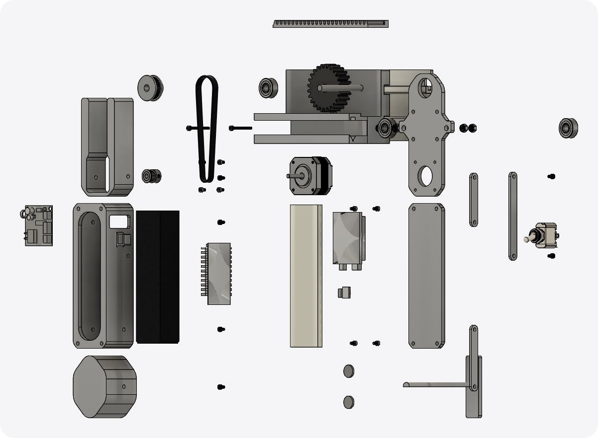

# OTO v2

**A compact whiteboard cleaner, and a testbed for printed mechanisms.**

OTO v2 builds on [OTO](https://github.com/Keem-tt/OTO-Whiteboard-Cleaner), a senior capstone project made with printed parts, Arduino control, and rack-and-pinion motion. The goal for v2: faster, cheaper, and sleeker.

*Paused*

Design notes only. No hardware or firmware files are published yet.

## Where it starts

The carriage from the original OTO, exploded.

The original repo holds the printed parts, the motor code, the capstone report, and media from the first build. OTO v2 keeps what that build taught and rethinks the rest: the mechanism, the printed parts, pad service, packaging, and cost.

Read about [the original OTO](docs/original-oto.md).

## What it explores

- Printed mechanism design
- Rail and chassis geometry
- Pad interface
- Fastener bosses
- Serviceability
- FDM constraints
- Measured behavior

## Open source, closed to contributions

Use it and change it under the licenses below. Pull requests are off.

Software is licensed under GPL-3.0-or-later, hardware under CERN-OHL-S-2.0, and documentation under CC BY-SA 4.0. See [License](LICENSE_NOTES.md).
