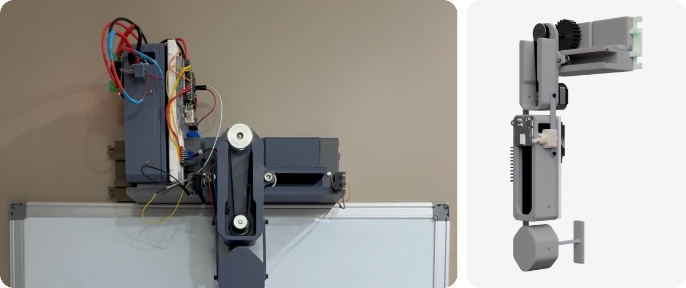
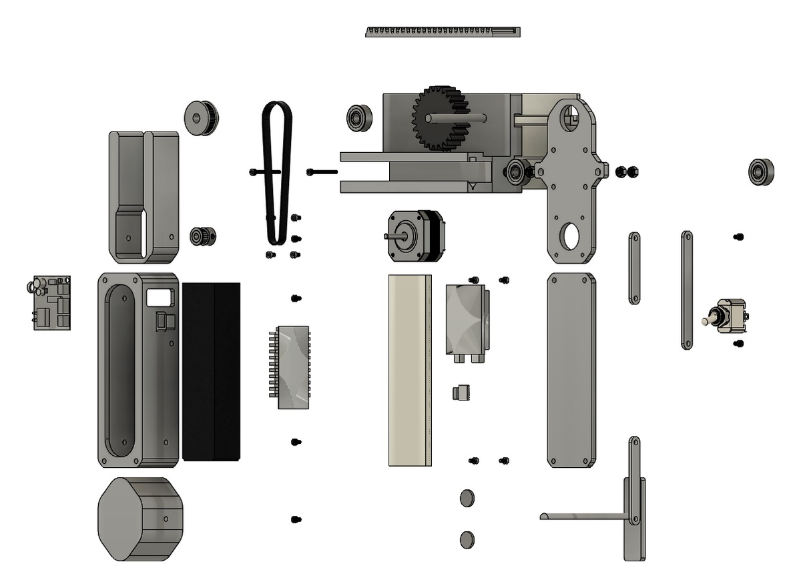

# The original OTO

OTO began as a senior capstone project: an automated whiteboard cleaner. See [the original repo](https://github.com/Keem-tt/OTO-Whiteboard-Cleaner).

The original OTO mid-sweep, and a render of its carriage. Neither picture is OTO v2.

## How it moved

A carriage rides a rail along the top of the board. A stepper motor turns a printed pinion through a short belt, and the pinion walks along a printed rack. The rack comes in 151 mm segments, so a wider board takes more segments. The printed parts use PLA+.

The carriage holds a foam and felt pad against the board. A limit switch sits at each end of the rail.

The original carriage, exploded.

## How it ran

An Arduino Uno runs the logic, and a TMC2209 driver runs the motor. A 3-cell LiPo battery powers it, with no cord to the wall.

At power-on, OTO runs to each end of the rail to find its travel. Press the button and it runs ten back-and-forth cycles, then returns to the left end. Hold the button for two seconds and it finds both ends again.

## What the capstone report measured

- Ten sweeps across a 1.5 ft by 0.5 ft section in under 20 seconds.
- Less than 5% residual ink in a 70 mm × 25 mm patch test.
- No wear was observed on the limit switches after more than 50 cycles.

## What it taught

- A belt across the board needs tensioning and stretches under load. A printed rack needs no tensioning, and one motor drives it.
- The early carriage leaned forward under its own weight.
- The pad dragged instead of gliding, and pressed unevenly.
- Splitting the rack into three-part plates improved alignment.
- The next fix: sensorless homing, to stop overtravel and jamming.

## What’s in the original repo

- STL files for the printed parts: rack segments, pinion, pod, cleaning arm, mounts, covers, tabs, and rail parts.
- Arduino code for stepper motion, calibration, limit-switch travel bounds, and button-driven clean modes.
- The capstone report: the problem, the requirements, the tradeoffs, the cost targets, the modular rack, and the iteration history.
- A turntable video of the carriage.

## What v2 asks

- Which parts of the rack-and-pinion approach are worth keeping?
- Which parts should be printed, and which should be off-the-shelf?
- Which printed parts were too bulky, too slow to print, or too hard to service?
- How should pad replacement and cleaning pressure be handled earlier in the design?
- Can it be faster, cheaper, and sleeker without losing repairability?
- What needs to be measured again?
